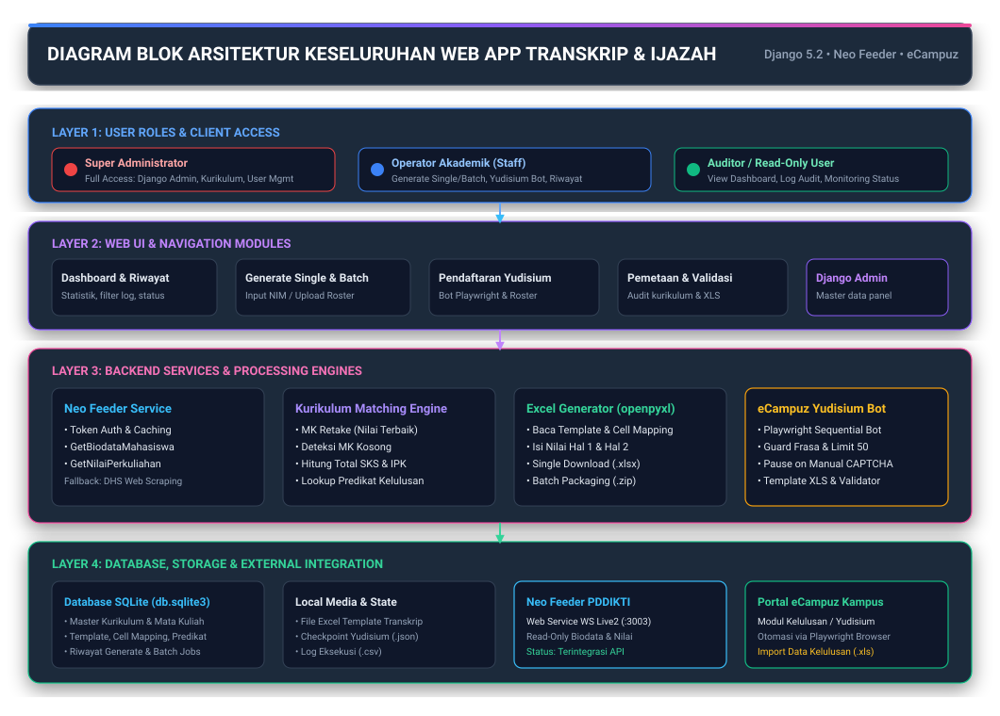
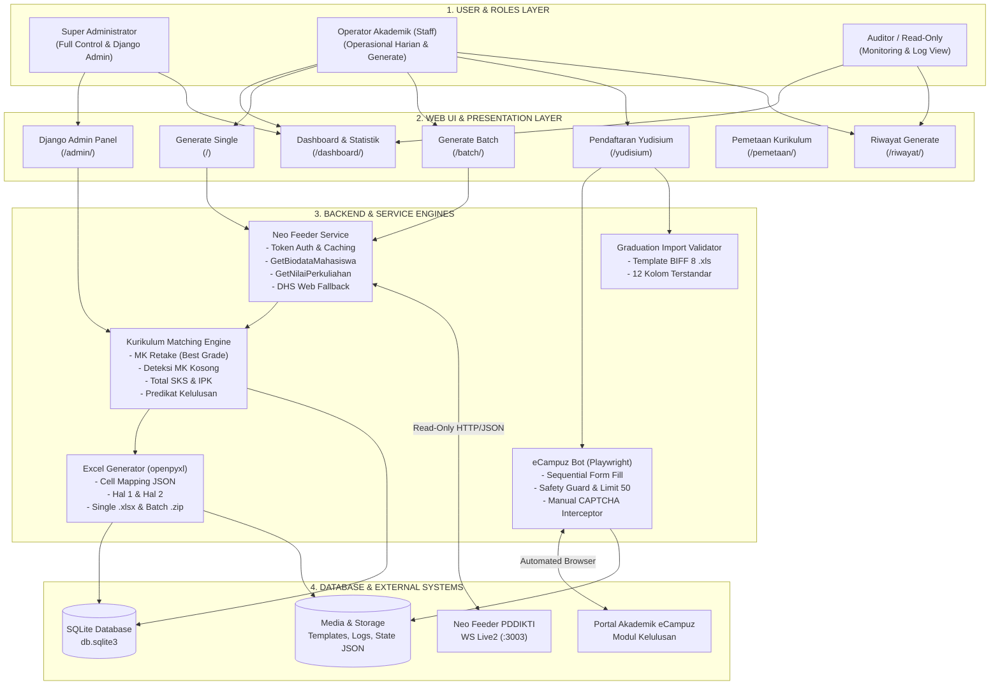
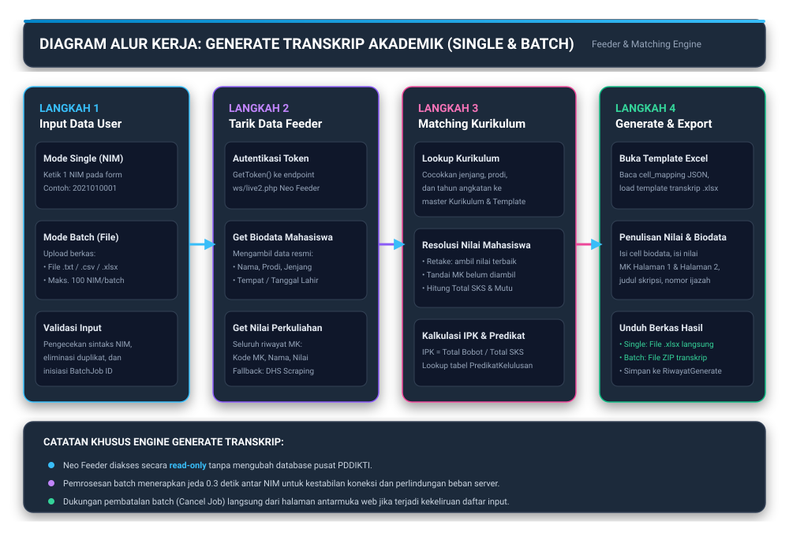
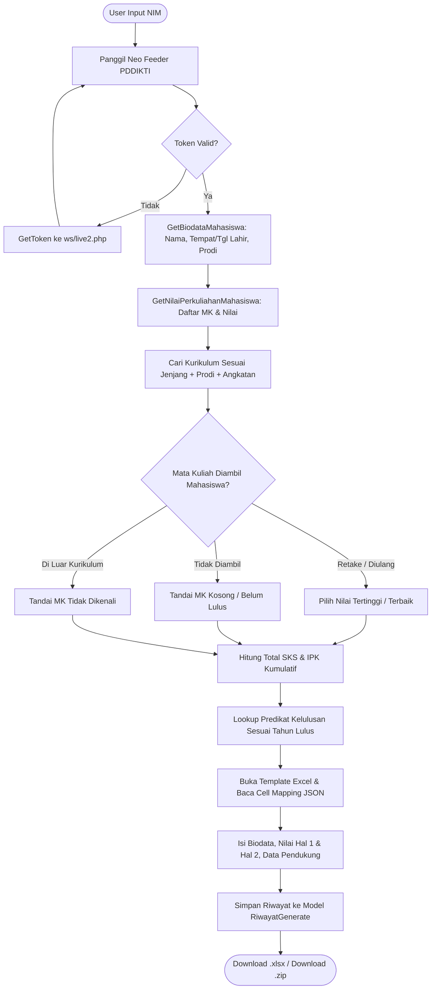
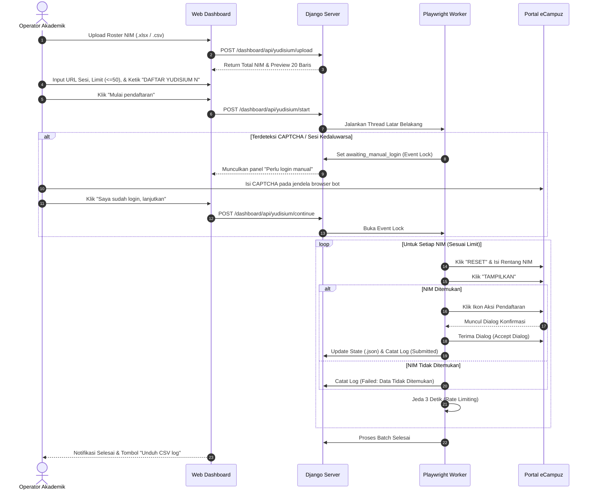
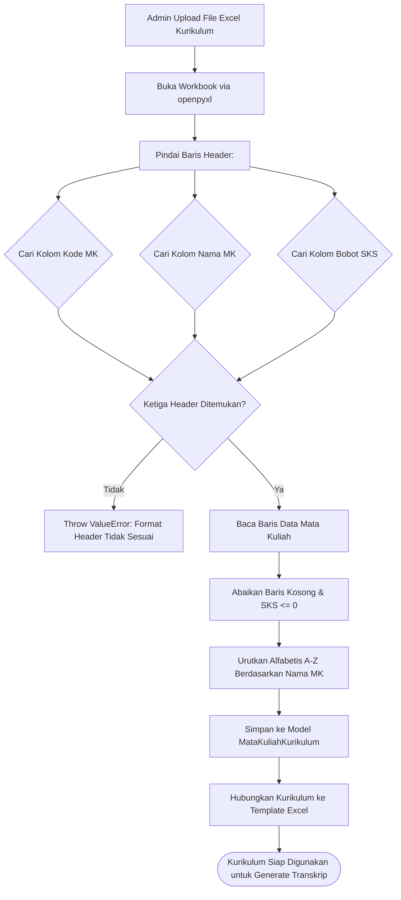
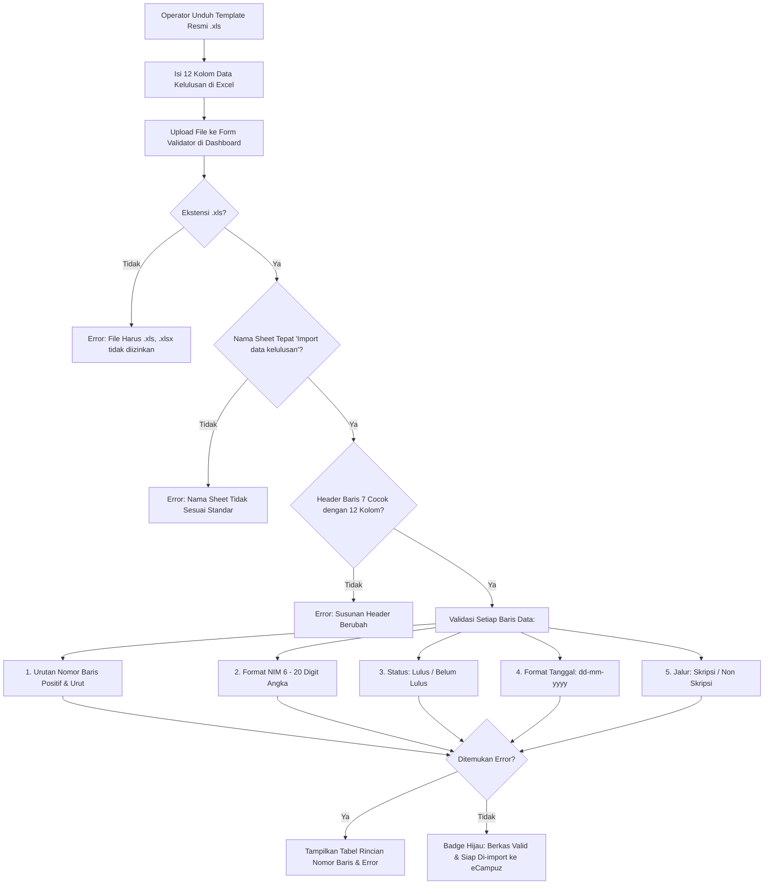
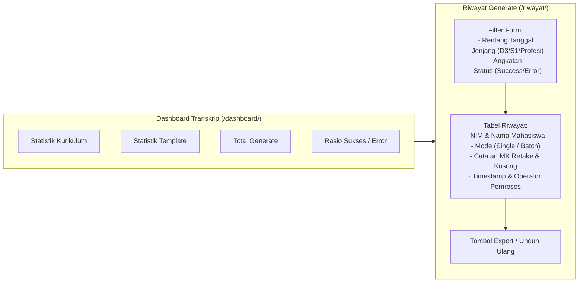

# Transkrip & Ijazah — Aplikasi Generate Transkrip Akademik & Otomasi Yudisium

Aplikasi web berbasis **Django** untuk menghasilkan transkrip akademik mahasiswa secara otomatis dan mengotomasi pendaftaran yudisium ke portal kampus. Data mahasiswa diambil langsung dari **Neo Feeder PDDIKTI**, dicocokkan dengan kurikulum yang tersimpan, lalu diekspor sebagai file Excel siap cetak. Modul otomasi juga dilengkapi bot Playwright untuk pendaftaran yudisium ke portal **eCampuz**.

---

## Daftar Isi

1. [Diagram Blok Arsitektur Keseluruhan](#1-diagram-blok-arsitektur-keseluruhan)
2. [Role Pengguna & Hak Akses](#2-role-pengguna--hak-akses)
3. [Alur Cara Kerja Pengguna (User Workflow)](#3-alur-cara-kerja-pengguna-user-workflow)
4. [Alur Kerja Setiap Fitur & Gambar Diagram](#4-alur-kerja-setiap-fitur--gambar-diagram)
   - [4.1 Fitur Generate Transkrip (Single & Batch)](#41-fitur-generate-transkrip-single--batch)
   - [4.2 Fitur Pendaftaran Yudisium & Otomasi eCampuz](#42-fitur-pendaftaran-yudisium--otomasi-ecampuz)
   - [4.3 Fitur Manajemen Kurikulum & Template Excel](#43-fitur-manajemen-kurikulum--template-excel)
   - [4.4 Fitur Validasi Import Data Kelulusan (.xls)](#44-fitur-validasi-import-data-kelulusan-xls)
   - [4.5 Fitur Dashboard & Riwayat Generate](#45-fitur-dashboard--riwayat-generate)
5. [Teknologi yang Digunakan](#5-teknologi-yang-digunakan)
6. [Struktur Proyek](#6-struktur-proyek)
7. [Model Data](#7-model-data)
8. [Konfigurasi Environment](#8-konfigurasi-environment)
9. [Cara Menjalankan](#9-cara-menjalankan)
10. [Akun Default](#10-akun-default)
11. [Catatan Penting Keamanan & Performa](#11-catatan-penting-keamanan--performa)

---

## 1. Diagram Blok Arsitektur Keseluruhan

Arsitektur aplikasi terbagi menjadi 4 lapisan (*layers*): **User & Roles Layer**, **Web UI Layer**, **Core Backend Services Layer**, dan **Storage & External Systems Layer**.

### Gambar Diagram Blok Arsitektur


---

### Diagram Arsitektur Berbasis Mermaid



---

## 2. Role Pengguna & Hak Akses

Aplikasi ini membagi hak akses ke dalam **3 tingkatan peran (roles)**:

| Role Pengguna | Tipe Akun | Hak Akses Utama | Tanggung Jawab Operasional |
|---|---|---|---|
| **Super Administrator** | Django Superuser (`is_superuser=True`) | Akses penuh 100% ke Django Admin (`/admin/`), Web UI, Manajemen User & Grup, Konfigurasi Integrasi. | Mengelola master kurikulum, upload template transkrip, mengatur cell mapping JSON, setting predikat, dan konfigurasi server. |
| **Operator Akademik** | Staff User (`is_staff=True`) | Akses penuh ke seluruh fitur operasional Web UI (`/`, `/batch/`, `/yudisium`, `/riwayat/`, `/pemetaan/`). | Melakukan generate transkrip harian (single/batch), menjalankan bot pendaftaran yudisium, dan memvalidasi file kelulusan. |
| **Auditor / Dosen / Viewer** | Basic User (`is_staff=False`) | Hak akses baca (*Read-Only*) ke Dashboard dan halaman Riwayat Generate. | Memantau statistik kelulusan, melihat riwayat ekspor transkrip, dan melakukan audit nilai tanpa hak mengubah data master. |

### Matriks Hak Akses Fitur (Permission Matrix)

| Fitur / Modul | Super Administrator | Operator Akademik | Auditor / Viewer |
|---|:---:|:---:|:---:|
| **Generate Transkrip Single (Per NIM)** | ✅ | ✅ | ❌ |
| **Generate Transkrip Batch (Upload File & ZIP)** | ✅ | ✅ | ❌ |
| **Batalkan Proses Batch (Cancel Job)** | ✅ | ✅ | ❌ |
| **Lihat Dashboard & Statistik** | ✅ | ✅ | ✅ |
| **Lihat Riwayat & Filter Log** | ✅ | ✅ | ✅ |
| **Eksekusi Bot Pendaftaran Yudisium** | ✅ | ✅ | ❌ |
| **Unduh Template & Validasi Kelulusan (.xls)** | ✅ | ✅ | ❌ |
| **Upload Excel Master Kurikulum** | ✅ | ❌ | ❌ |
| **Upload Template Transkrip & Cell Mapping** | ✅ | ❌ | ❌ |
| **Atur Rentang IPK Predikat Kelulusan** | ✅ | ❌ | ❌ |
| **Kelola Data Pendukung (Judul TA & Ijazah)** | ✅ | ✅ | ❌ |
| **Manajemen Pengguna (Tambah / Hapus Akun)** | ✅ | ❌ | ❌ |

---

## 3. Alur Cara Kerja Pengguna (User Workflow)

Berikut adalah tahapan kerja pengguna berdasarkan peran masing-masing:

### A. Alur Kerja Super Administrator
1. **Login ke Django Admin** melalui URL `/admin/`.
2. **Setup Template Excel**:
   - Masukkan file template `.xlsx` yang sudah didesain (dengan logo kampus dan format transkrip resmi).
   - Tentukan kapasitas total MK dan jumlah baris MK pada halaman 1.
   - Atur konfigurasi koordinat sel pada kolom **Cell Mapping JSON** (nama, NIM, tempat tanggal lahir, tabel nilai, IPK, dsb.).
3. **Upload Kurikulum Baru**:
   - Buat entri Kurikulum baru, pilih jenjang (D3/S1/Profesi), prodi, dan tahun angkatan.
   - Unggah file Excel daftar mata kuliah kurikulum. Sistem akan membaca Kode MK, Nama MK, dan SKS secara otomatis serta mengurutkannya alfabetis A-Z.
   - Hubungkan kurikulum tersebut ke Template Excel yang telah dibuat.
4. **Konfigurasi Predikat Kelulusan**:
   - Tentukan rentang IPK dan tahun kelulusan untuk predikat: *Pujian*, *Sangat Memuaskan*, dan *Memuaskan*.
5. **Manajemen Akun Operator**:
   - Menambahkan akun staf akademik dan memberikan status aktif/staf.

---

### B. Alur Kerja Operator Akademik
1. **Login ke Aplikasi** menggunakan akun staf di halaman `/login/`.
2. **Generate Transkrip Single**:
   - Masuk ke menu utama (`/`).
   - Masukkan 1 NIM mahasiswa &rarr; Klik **Generate Transkrip**.
   - Berkas Excel `.xlsx` transkrip langsung terunduh secara otomatis.
3. **Generate Transkrip Batch**:
   - Masuk ke menu **Generate Batch** (`/batch/`).
   - Unggah berkas `.txt`, `.csv`, atau `.xlsx` yang berisi daftar NIM (maks. 100 mahasiswa).
   - Klik **Mulai Generate** dan pantau progress bar secara langsung.
   - Jika ada kesalahan daftar NIM, operator dapat menekan tombol **Batalkan**.
   - Setelah selesai, unduh arsip berkas transkrip berupa file `.zip`.
4. **Pendaftaran Yudisium ke eCampuz**:
   - Masuk ke menu **Yudisium** (`/yudisium`).
   - Unggah berkas roster mahasiswa lulus &rarr; Klik **Validasi & preview**.
   - Masukkan URL modul kelulusan eCampuz aktif, batas batch (maks 50), dan ID sesi.
   - Centang persetujuan kewenangan dan ketik frasa konfirmasi: `DAFTAR YUDISIUM <N>`.
   - Klik **Mulai pendaftaran**. Jika muncul instruksi login manual, isi CAPTCHA pada browser bot lalu klik **Saya sudah login, lanjutkan**.
   - Unduh laporan hasil pendaftaran berupa **CSV Log**.
5. **Validasi File Import Kelulusan**:
   - Unduh template kelulusan resmi (.xls).
   - Isi nomor ijazah dan tanggal yudisium.
   - Validasi berkas pada form validator di halaman yudisium sebelum diunggah ke eCampuz.

---

### C. Alur Kerja Auditor / Viewer
1. **Login ke Aplikasi**.
2. **Buka Dashboard**: Memantau total kurikulum, template terdaftar, total transkrip yang telah digenerate, dan rasio keberhasilan generate.
3. **Buka Riwayat Generate**: Memeriksa log audit per mahasiswa, melihat apakah terdapat mata kuliah retake, mata kuliah kosong, atau kendala nilai yang dialami mahasiswa.

---

## 4. Alur Kerja Setiap Fitur & Gambar Diagram

---

### 4.1 Fitur Generate Transkrip (Single & Batch)

Fitur ini bertugas mengolah data nilai mahasiswa dari PDDIKTI menjadi transkrip akademik resmi dalam format Microsoft Excel.

#### Gambar Alur Kerja Generate Transkrip


#### Diagram Alur Logika Pencocokan (Matching Engine)


---

### 4.2 Fitur Pendaftaran Yudisium & Otomasi eCampuz

Fitur ini mengotomasi pendaftaran mahasiswa yang telah lulus sidang ke portal akademik eCampuz menggunakan peramban Playwright dengan sistem proteksi keamanan berjenjang.

#### Gambar Diagram Blok Yudisium


#### Diagram Alur Kerja Eksekusi Bot


---

### 4.3 Fitur Manajemen Kurikulum & Template Excel

Fitur ini memudahkan administrator mengunggah kurikulum dari file Excel tanpa perlu mengetik ratusan mata kuliah satu per satu.

#### Gambar Alur Manajemen Kurikulum


#### Diagram Alur Parser Excel Kurikulum


---

### 4.4 Fitur Validasi Import Data Kelulusan (.xls)

Setelah pendaftaran yudisium selesai, data kelulusan (nomor ijazah, tanggal SK yudisium, status, dsb.) di-import ke eCampuz menggunakan format Excel legacy BIFF 8 (`.xls`).



---

### 4.5 Fitur Dashboard & Riwayat Generate

Halaman dashboard dan riwayat berfungsi untuk audit akademik, pemantauan status generate, serta analisis performa transkrip.



---

## 5. Teknologi yang Digunakan

- **Backend**: Python 3.11, Django 5.2 (Architecture MTV: Model-Template-View)
- **Database**: SQLite3 (Bawaan lokal, mudah dimigrasi ke PostgreSQL/MySQL)
- **Otomasi Browser**: Playwright (Chromium headless/headful) untuk eCampuz Bot
- **Pengolah Berkas Excel**:
  - `openpyxl`: Menulis transkrip hasil generate (`.xlsx`) dan membaca roster
  - `xlwt`: Menghasilkan template kelulusan resmi format legacy BIFF 8 (`.xls`)
  - `xlrd`: Membaca dan memvalidasi berkas import kelulusan eCampuz (`.xls`)
- **Integrasi Eksternal**:
  - **Neo Feeder PDDIKTI**: Protokol HTTP/JSON (Web Service `ws/live2.php`, mode read-only)
  - **DHS Web Fallback**: Pengambilan nilai darurat jika service Neo Feeder bermasalah
- **Frontend & Styling**: Vanilla CSS + Tailwind-inspired Glassmorphism UI (bebas dependensi framework berat luar)
- **Autentikasi**: Django Built-in Session Authentication & Role Authorization

---

## 6. Struktur Proyek

```
Transkrip/                                      ← Root repositori
├── README.md                                   ← Dokumentasi utama proyek
├── cara kerja pendaftaran yudisium.md          ← Dokumentasi teknis pendaftaran yudisium
├── diagram_block_webapp.svg                    ← Gambar arsitektur keseluruhan web app
├── diagram_alur_generate.svg                   ← Gambar alur kerja generate transkrip
├── diagram_block_yudisium.svg                  ← Gambar diagram blok otomasi yudisium
├── diagram_alur_kurikulum.svg                  ← Gambar alur master kurikulum
└── artifacts/
    └── transkrip-app/                          ← Direktori aplikasi Django
        ├── manage.py                           ← CLI perintah Django
        ├── run.sh                              ← Script startup otomatis
        ├── .env.example                        ← Template variabel environment
        ├── db.sqlite3                          ← Database lokal SQLite
        ├── core/                               ← Aplikasi utama transkrip
        │   ├── models.py                       ← Template, Kurikulum, Riwayat, dsb.
        │   ├── views.py                        ← Logika generate single, batch, riwayat
        │   ├── admin.py                        ← Panel Django Admin & parser kurikulum
        │   ├── forms.py                        ← Form input & filter
        │   └── services/
        │       ├── feeder.py                   ← Client koneksi Neo Feeder PDDIKTI
        │       ├── matching.py                 ← Pencocokan kurikulum & IPK
        │       └── excel_gen.py                ← Pengisian sel template Excel
        ├── dashboard/                          ← Modul dashboard & otomasi eCampuz
        │   ├── views.py                        ← Controller dashboard & API yudisium
        │   ├── jobs.py                         ← Thread background runner & security
        │   └── services/
        │       └── yudisium_import.py          ← Template & validator import .xls
        ├── ecampuz/                            ← Mesin otomasi browser
        │   └── yudisium_browser.py             ← Bot Playwright otomasi form yudisium
        ├── templates/                          ← Template HTML antarmuka
        │   ├── base.html                       ← Layout dasar
        │   ├── dashboard.html                  ← Tampilan dashboard utama
        │   ├── generate_single.html            ← Tampilan generate single NIM
        │   ├── generate_batch.html             ← Tampilan generate batch file
        │   ├── riwayat.html                    ← Tampilan riwayat generate
        │   └── admin/                          ← Tampilan kustom Django Admin
        └── static/                             ← Aset statis (CSS, JS, ikon)
```

---

## 7. Model Data

| Model | Tabel Database | Fungsi & Peran |
|---|---|---|
| `Template` | `core_template` | Menyimpan file template transkrip (`.xlsx`), batas baris halaman 1, total MK, dan konfigurasi koordinat **Cell Mapping JSON**. |
| `Kurikulum` | `core_kurikulum` | Kurikulum per jenjang (D3/S1/Profesi), prodi, dan tahun angkatan. Terhubung relasi *ForeignKey* ke `Template`. |
| `MataKuliahKurikulum` | `core_matakuliahkurikulum` | Daftar seluruh mata kuliah (Kode MK, Nama MK, SKS, Urutan Alfabetis) yang menyusun satu Kurikulum. |
| `PredikatKelulusan` | `core_predikatkelulusan` | Aturan batas minimum dan maksimum IPK terhadap predikat kelulusan (*Pujian*, *Sangat Memuaskan*, *Memuaskan*) per rentang tahun lulus. |
| `DataPendukung` | `core_datapendukung` | Informasi tambahan spesifik per mahasiswa (NIM): Judul Skripsi / Tugas Akhir, Nomor Seri Ijazah, dan Nama Dekan Penandatangan. |
| `RiwayatGenerate` | `core_riwayatgenerate` | Log audit eksekusi transkrip: NIM, nama mahasiswa, jenjang, mode (*Single* / *Batch*), catatan MK retake/kosong, status sukses/gagal, waktu, dan user pembuat. |
| `BatchJob` | `core_batchjob` | Menyimpan status pekerjaan batch (*running*, *cancelled*, *completed*) untuk mendukung fitur pembatalan (*cancel*) secara realtime. |

---

## 8. Konfigurasi Environment

Salin file `.env.example` ke `.env` lalu sesuaikan isinya:

```bash
cp artifacts/transkrip-app/.env.example artifacts/transkrip-app/.env
```

| Variabel Environment | Wajib | Keterangan |
|---|:---:|---|
| `SECRET_KEY` | ✅ | Kunci enkripsi Django. Ganti dengan string acak panjang di production. |
| `DEBUG` | — | `True` untuk mode pengembangan, `False` untuk production. |
| `ALLOWED_HOSTS` | — | Daftar host/domain yang diizinkan (misal: `localhost,127.0.0.1`). |
| `FEEDER_HOST` | ✅* | IP atau hostname server Neo Feeder PDDIKTI (misal: `192.168.1.100`). |
| `FEEDER_USERNAME` | ✅* | Username akun web service Neo Feeder. |
| `FEEDER_PASSWORD` | ✅* | Password akun web service Neo Feeder. |
| `DEFAULT_NAMA_DEKAN`| — | Nama dekan default yang tercetak pada transkrip jika data per NIM kosong. |
| `CSRF_TRUSTED_ORIGINS`| — | Daftar origin CSRF tepercaya (diperlukan bila menggunakan reverse proxy Nginx). |

> \* *Wajib diisi agar proses generate transkrip dapat menarik biodata dan nilai mahasiswa dari Neo Feeder PDDIKTI.*

---

## 9. Cara Menjalankan

### Menjalankan Server Lokal (Linux / macOS):

```bash
cd artifacts/transkrip-app
chmod +x run.sh
PORT=8080 ./run.sh
```

Skrip `run.sh` akan secara otomatis melakukan pengecekan virtual environment, menjalankan migrasi database, mengumpulkan file statis, membuat superuser default jika belum ada, dan menjalankan server pada port yang ditentukan.

Aplikasi dapat dibuka melalui browser pada alamat:
`http://localhost:8080`

---

## 10. Akun Default

Saat pertama kali dijalankan, sistem secara otomatis menyiapkan akun administrator bawaan:

| Parameter | Nilai Bawaan |
|---|---|
| **URL Login** | `http://localhost:8080/login/` atau `/admin/` |
| **Username** | `admin` |
| **Password** | `admin123` |
| **Hak Akses** | Super Administrator (Full Access) |

> ⚠️ **PENTING**: Segera ubah kata sandi default setelah instalasi pertama kali menggunakan perintah:
> ```bash
> python manage.py changepassword admin
> ```

---

## 11. Catatan Penting Keamanan & Performa

1. **Akses Read-Only ke Neo Feeder**:
   Integrasi ke Neo Feeder PDDIKTI hanya memanggil endpoint `GetToken`, `GetBiodataMahasiswa`, dan `GetNilaiPerkuliahanMahasiswa`. Tidak ada instruksi penulisan (*Insert/Update/Delete*) ke server PDDIKTI, sehingga sangat aman.
2. **Rate Limiting & Anti-Flooding**:
   Pemrosesan batch transkrip menerapkan jeda 0.3 detik per NIM, sedangkan bot yudisium menerapkan jeda 3 detik per mahasiswa untuk menjaga stabilitas koneksi jaringan dan server target.
3. **Penyimpanan Berkas Media**:
   File template transkrip disimpan di direktori `media/templates/` dan dikecualikan dari Git (*gitignored*) untuk menjaga kerahasiaan format dokumen resmi institusi.
4. **Database SQLite Versi Git**:
   File `db.sqlite3` dilacak di Git repositori agar master kurikulum dan template awal dapat langsung digunakan saat aplikasi di-clone.
5. **Keamanan Sesi Lokal Yudisium**:
   API eksekusi pendaftaran yudisium eCampuz diproteksi oleh fungsi `_is_local_operator_request` yang menolak request dari luar IP lokal host demi mencegah akses bot tanpa otorisasi langsung dari operator kampus.
