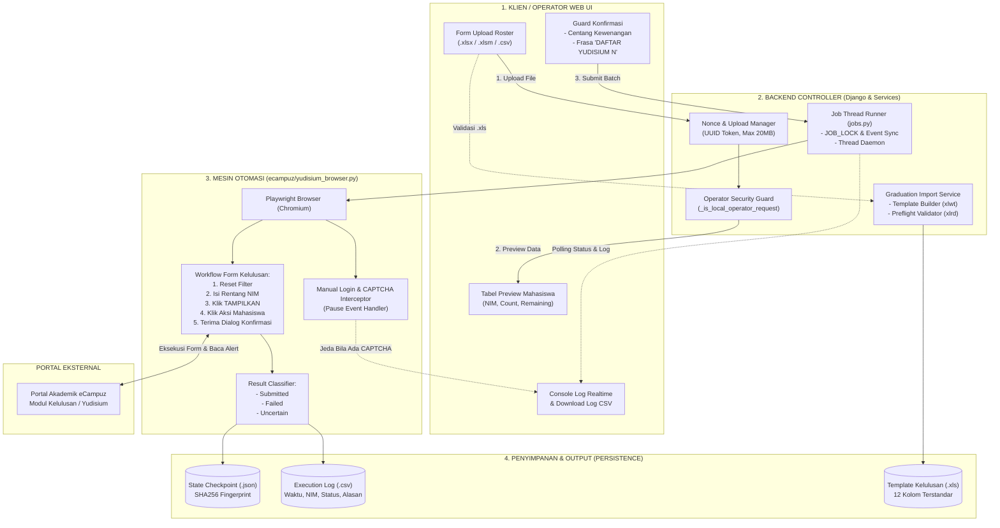
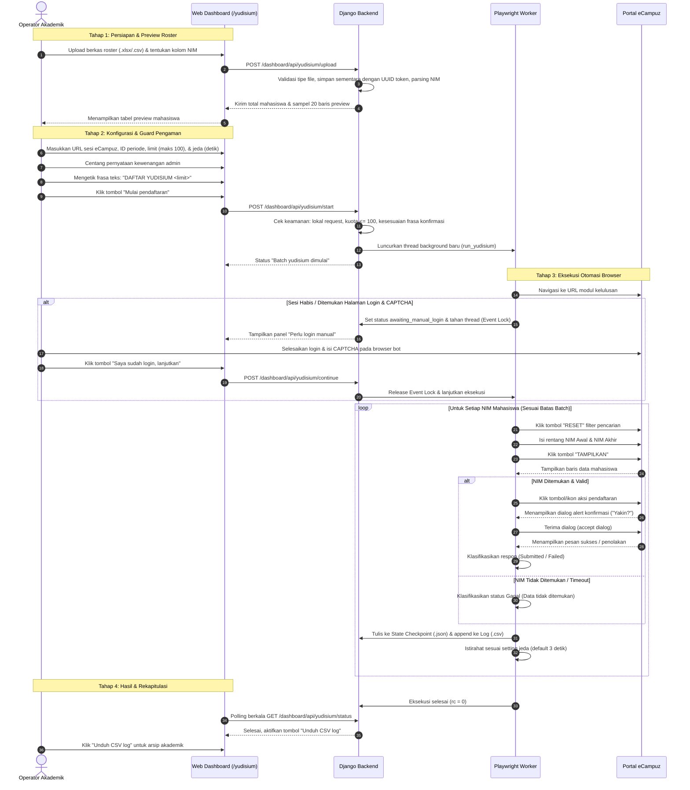

# Cara Kerja & Panduan Penggunaan Pendaftaran Yudisium

Dokumentasi teknis arsitektur, diagram blok, alur sistem, serta panduan operasional pengguna untuk modul **Pendaftaran Yudisium eCampuz**.

---

## Daftar Isi
1. [Gambaran Umum Sistem](#1-gambaran-umum-sistem)
2. [Diagram Blok Arsitektur](#2-diagram-blok-arsitektur)
3. [Diagram Alur Proses (Flowchart)](#3-diagram-alur-proses-flowchart)
4. [Mekanisme Teknis & Keamanan](#4-mekanisme-teknis--keamanan)
5. [Panduan Penggunaan bagi Pengguna / Operator](#5-panduan-penggunaan-bagi-pengguna--operator)
6. [Struktur & Format File Data](#6-struktur--format-file-data)
7. [Penanganan Kendala (Troubleshooting)](#7-penanganan-kendala-troubleshooting)

---

## 1. Gambaran Umum Sistem

Modul **Pendaftaran Yudisium** dirancang untuk mengotomasi dan mengamankan alur pendaftaran mahasiswa lulus ke portal akademik kampus (**eCampuz**). 

Sistem ini memiliki **dua pilar fungsionalitas**:

1. **Otomasi Pendaftaran Browser (Playwright Bot Engine)**:
   * Mengambil daftar mahasiswa dari berkas roster (`.xlsx`, `.xlsm`, atau `.csv`).
   * Membuka sesi eCampuz pada modul Kelulusan (*Tambah Mahasiswa Lain*).
   * Melakukan pencarian NIM berurutan, menangani dialog/konfirmasi, dan mencatat status setiap pendaftaran.
   * Dilengkapi sistem checkpoint state berkas dan log CSV agar proses dapat dilanjutkan (*idempotent*) tanpa risiko pendaftaran ganda.

2. **Template & Preflight Validator Import Kelulusan (.xls BIFF 8)**:
   * Menyediakan template resmi eCampuz berformat Excel 97-2003 (`.xls`) dengan 12 kolom terstandarisasi.
   * Menyediakan mesin validasi mandiri (*preflight validation*) sebelum file diunggah ke menu *Pengelolaan Yudisium &rarr; Import Data Kelulusan* di eCampuz.

---

## 2. Diagram Blok Arsitektur

Berikut adalah diagram blok hubungan antar komponen dalam sistem pendaftaran yudisium:

### Gambar Diagram Blok Visual


---

### Diagram Blok Berbasis Mermaid
Bila dokumen dibuka menggunakan Markdown Viewer (GitHub, VS Code Markdown Preview, Obsidian, atau Notion), diagram berikut akan ter-render secara interaktif:



---

## 3. Diagram Alur Proses (Flowchart)

Diagram alur urutan komunikasi (*Sequence Flow*) dari awal hingga akhir:



---

## 4. Mekanisme Teknis & Keamanan

Untuk menjamin keandalan data dan integritas portal kampus, sistem menerapkan sejumlah kontrol proteksi (*safety guards*):

| Lapisan Keamanan | Fungsi & Implementasi Teknis |
|---|---|
| **Local Operator Only** | Fungsi `_is_local_operator_request` membatasi akses API yudisium hanya dari alamat loopback (`127.0.0.1` / `localhost`). Akses dari luar jaringan diblokir (HTTP 403). |
| **Strict Confirmation Phrase** | Mencegah salah klik atau pengiriman tidak sengaja. Operator wajib mengetik kalimat `DAFTAR YUDISIUM <N>` secara presisi sebelum tombol aktif. |
| **Batas Batch Kuota (Max 50)** | Konstanta `YUDI_MAX_BATCH = 50` membatasi jumlah baris per eksekusi agar tidak menyebabkan *rate limiting* atau membebani server portal. |
| **Idempotensi & Checkpoint Fingerprint** | Berkas checkpoint `.json` menghitung *hash SHA256* dari isi file roster + ID periode. Mahasiswa yang sudah sukses didaftarkan tidak akan diproses ulang. |
| **Non-Destructive Pause (Event Lock)** | Thread bot dikontrol oleh `threading.Event()`. Saat bertemu CAPTCHA, bot masuk mode siaga tanpa mematikan sesi peramban. |
| **Pemisahan File Roster & Kelulusan** | Roster hanya dipakai untuk pendaftaran; pengisian nilai/predikat/ijazah dilakukan terpisah menggunakan template Excel resmi agar tidak mengubah data kelayakan akademik secara sepihak. |

---

## 5. Panduan Penggunaan bagi Pengguna / Operator

### A. Persiapan Awal
1. Siapkan daftar mahasiswa yang telah lulus sidang dan disetujui untuk yudisium dalam bentuk file **Excel (`.xlsx`, `.xlsm`)** atau **CSV (`.csv`)**.
2. Pastikan file memiliki satu kolom yang memuat NIM mahasiswa (misalnya dengan judul kolom `NIM`).
3. Pastikan kredensial akun eCampuz sudah tersimpan melalui menu pengaturan kredensial.

---

### B. Langkah 1: Unduh Template, Isi, & Upload Roster
1. Buka aplikasi web di browser Anda: `http://localhost:8080/yudisium` (atau klik menu **Yudisium** di dashboard).
2. Pada panel **1. Roster mahasiswa**:
   * Klik tombol **Unduh template roster (.xlsx)** di bagian kanan atas panel 1 untuk mendapatkan format resmi yang sudah diatur agar 100% kompatibel dengan bot.
   * Buka file `Template_Roster_Pendaftaran_Yudisium.xlsx` tersebut, lalu masukkan daftar NIM mahasiswa yang akan didaftarkan (kolom `NIM` sudah terformat sebagai teks `@` agar angka nol di awal tidak hilang).
   * Simpan file Excel tersebut.
3. Unggah file kembali ke sistem:
   * Klik **Choose File** pada *File CSV / Excel* dan pilih file roster yang sudah diisi.
   * Pastikan nama kolom NIM terisi `NIM` (sesuai template).
   * Klik tombol **Validasi & preview**.
4. Panel **Preview roster** akan muncul di bawahnya. Periksa apakah daftar NIM yang ditampilkan sudah sesuai dengan data yang akan didaftarkan.

---

### C. Langkah 2: Konfigurasi Batch
Pada panel **2. Jalankan batch**, lengkapi parameter berikut:
1. **URL halaman Tambah - Mahasiswa Lain**:
   * Buka portal eCampuz pada tab browser terpisah.
   * Masuk ke modul *Kelulusan / Yudisium &rarr; Pendaftaran Yudisium*.
   * Salin URL halaman **Tambah - Pilih Mahasiswa** (atau URL menu **Pendaftaran Yudisium**) pada bilah alamat browser, lalu tempel (*paste*) ke kolom input ini.
   * Token `act` pada URL eCampuz dapat berubah setelah login ulang. Bot akan mencari ulang URL Tambah yang aktif dari menu **Pendaftaran Yudisium** bila URL lama hanya menampilkan menu; jadi gunakan URL dari sesi yang sedang aktif.
2. **Maksimum NIM batch ini**: Masukkan jumlah mahasiswa yang akan didaftarkan pada batch ini (antara `1` s.d. `100`). Disarankan memulai dengan batch kecil (misal: `5` mahasiswa) untuk memastikan sesi berjalan lancar.
3. **Jeda antar mahasiswa (detik)**: Waktu tunggu antar pendaftaran mahasiswa (standar: `3.0` detik).
4. **ID periode/sesi yudisium**: Masukkan penanda sesi, misalnya: `Ganjil 2026/2027` atau `Periode Yudisium Oktober 2026`. ID ini digunakan untuk mencatat riwayat log.
5. *(Opsional)* **Coba ulang baris berstatus Gagal**: Centang opsi ini jika Anda ingin mengulangi mahasiswa yang pada proses sebelumnya berstatus *Gagal*.

---

### D. Langkah 3: Konfirmasi Keamanan & Memulai Pendaftaran
1. Centang kotak persetujuan kewenangan:
   > ☑ *"Saya memastikan roster sudah diverifikasi admin dan berwenang menjalankan pendaftaran."*
2. Perhatikan placeholder pada kolom konfirmasi (misalnya tertulis `DAFTAR YUDISIUM 10`).
3. Ketikkan kalimat tersebut secara persis huruf besar/kecilnya ke dalam kolom *Ketik frasa konfirmasi*.
4. Tombol **Mulai pendaftaran** akan berubah menjadi aktif (berwarna biru). Klik tombol tersebut untuk memulai proses.

---

### E. Langkah 4: Penanganan Login Manual & CAPTCHA (Bila Diperlukan)
1. Jika portal kampus mewajibkan pengisian CAPTCHA atau sesi login telah kedaluwarsa, dashboard akan memunculkan kotak kuning: **"Perlu login manual"**.
2. Jendela peramban Chromium yang dijalankan oleh bot akan muncul di layar.
3. Silakan ketik username, password, dan kode CAPTCHA langsung pada jendela browser tersebut sampai berhasil masuk.
4. Setelah portal terbuka di halaman pendaftaran, kembali ke tab dashboard Transkrip lalu klik tombol:
   **"Saya sudah login, lanjutkan"**.
5. *(Opsi Pembatalan)* Jika ingin membatalkan proses pada tahap ini, klik tombol merah **"Batalkan batch"**. Bot akan menutup sesi dan mereset status sistem ke kondisi siap.
6. Bot akan langsung melanjutkan pendaftaran sisa antrean mahasiswa secara otomatis.

---

### F. Langkah 5: Memantau Log, Batalkan/Reset, & Mengunduh Rekapitulasi
1. Pantau jalannya proses pada panel **Status dan log**. Sistem akan menampilkan teks konsol baris demi baris:
   ```text
   [web] Memulai batch 10 NIM dari roster mahasiswa_lulus.xlsx.
   [1/10] SUKSES 202101001: Pendaftaran berhasil dikonfirmasi oleh halaman.
   [2/10] SUKSES 202101002: Pendaftaran berhasil dikonfirmasi oleh halaman.
   ...
   ```
2. **Tombol "Batalkan / Reset Job"**:
   Jika di tengah proses pendaftaran bot terasa macet, koneksi portal terputus, atau Anda ingin mengganti file roster, klik tombol merah **"Batalkan / Reset Job"** pada header panel *Status dan log*. Sistem akan langsung menghentikan proses peramban dan mengembalikan tombol *Mulai pendaftaran* ke status aktif tanpa harus me-restart server.
3. Setelah seluruh mahasiswa selesai diproses, status badge akan berubah menjadi **Selesai**.
4. Klik tombol **Unduh CSV log** yang muncul di pojok kanan panel log untuk mengunduh rekap hasil pendaftaran.

---

### G. Fitur Penyimpanan Otomatis URL & Periode
* Setiap kali batch dijalankan, URL halaman pendaftaran dan ID Periode akan otomatis disimpan ke konfigurasi server (`web.json`) dan `localStorage` peramban.
* Saat Anda membuka kembali halaman Yudisium di sesi berikutnya, kolom URL dan ID Periode sudah langsung terisi (*auto-filled*).
* URL eCampuz memakai token `act` yang dapat berubah setelah login ulang. Jangan menganggap URL yang terisi otomatis selalu masih valid: jika URL lama hanya membuka menu, bot akan mencari URL **Pendaftaran Yudisium &rarr; Tambah** yang aktif secara otomatis. Jika pencarian otomatis gagal, tempel URL dari sesi eCampuz yang sedang aktif.
* Mahasiswa yang sudah terdaftar pada semester target akan dikenali dari menu **Pengelolaan Yudisium** dan dilewati dengan status `SUDAH ADA`, sehingga batch aman diulang tanpa membuat duplikat.

---

### G. Langkah 6: Pengisian & Validasi Template Kelulusan (.xls)
Setelah mahasiswa terdaftar di yudisium, langkah selanjutnya adalah melengkapi data kelulusan (nomor ijazah, tanggal SK yudisium, predikat, dsb.):
1. Pada panel **3. Data Kelulusan setelah pendaftaran**, klik tombol **Unduh template .xls**.
2. Buka file hasil unduhan menggunakan Microsoft Excel.
3. Isi data mahasiswa pada baris ke-8 dan seterusnya sesuai format yang ditentukan.
4. Simpan kembali berkas dalam format Excel 97-2003 (`.xls`).
5. Pada form *File hasil isi (.xls)* di dashboard, pilih berkas Anda lalu klik **Validasi file kelulusan**.
6. Dashboard akan memeriksa kelayakan berkas:
   * Jika ada kesalahan (misal format tanggal salah atau NIM duplikat), tabel error akan menampilkan nomor baris dan keterangan kesalahan secara detail.
   * Jika validasi lolos (*badge hijau: Valid*), berkas tersebut telah memenuhi standar dan siap di-upload ke menu *Pengelolaan Yudisium &rarr; Import Data Kelulusan* di portal eCampuz.

---

## 6. Struktur & Format File Data

### 1. Berkas Roster Pendaftaran (Input Bot)
* **Ekstensi**: `.xlsx`, `.xlsm`, atau `.csv` (UTF-8).
* **Kolom Wajib**: Minimal satu kolom berisi Nomor Induk Mahasiswa (NIM).
* **Contoh Isi Roster**:

| No | NIM | Nama Mahasiswa | Program Studi |
|:---:|:---:|:---|:---|
| 1 | 2021010001 | Ahmad Fadillah | S1 Teknik Informatika |
| 2 | 2021010002 | Siti Nurhaliza | S1 Sistem Informasi |

---

### 2. Berkas Import Data Kelulusan Resmi (.xls)
Sesuai format modul eCampuz, berkas memiliki spesifikasi:
* **Nama Sheet**: Harus tepat `Import data kelulusan`
* **Posisi Header**: Tepat berada pada baris ke-7 (index Excel row 7)
* **Baris Data**: Dimulai pada baris ke-8
* **12 Kolom Terstandarisasi**:

| No | Nama Kolom Header | Format / Nilai yang Diterima | Contoh |
|:---:|:---|:---|:---|
| 1 | `No` | Angka urut positif (1, 2, 3, ...) | `1` |
| 2 | `NIM` | Teks angka 6 s.d. 20 digit | `2021010001` |
| 3 | `Nama` | Teks nama lengkap mahasiswa | `Ahmad Fadillah` |
| 4 | `Status Lulus` | Teks: `Lulus` atau `Belum Lulus` | `Lulus` |
| 5 | `Semester Lulus` | Format semester akademik | `Gasal 2026-2027` |
| 6 | `Tanggal Yudisium` | Format tanggal `dd-mm-yyyy` | `15-08-2026` |
| 7 | `No Surat Yudisium` | Nomor SK Yudisium Fakultas/Universitas | `SK-YUD/FTI/VIII/2026` |
| 8 | `Tanggal Keluar/Lulus` | Format tanggal `dd-mm-yyyy` | `15-08-2026` |
| 9 | `Jalur Lulus (Skripsi/Non Skripsi)` | Teks: `Skripsi` atau `Non Skripsi` | `Skripsi` |
| 10 | `Nomor Ijazah` | Nomor Seri Ijazah Nasional (NINA) / Lokal | `12345/UNIV/2026` |
| 11 | `Tanggal Ijazah` | Format tanggal `dd-mm-yyyy` | `20-08-2026` |
| 12 | `No ijazah lain` | Opsional (nomor sertifikat pendamping) | `-` |

---

## 7. Penanganan Kendala (Troubleshooting)

| Gejala / Pesan Error | Penyebab Utama | Solusi Tindakan |
|---|---|---|
| **"Aksi yudisium hanya tersedia dari browser lokal"** | Dashboard diakses dari IP jaringan eksternal / remote. | Buka aplikasi langsung di komputer lokal server (`http://localhost:8080`). |
| **"Batas batch melebihi jumlah NIM pada roster"** | Angka limit diisi lebih besar daripada jumlah mahasiswa di file roster. | Sesuaikan nilai limit dengan jumlah baris yang ada di preview. |
| **"Ketik tepat: DAFTAR YUDISIUM <N>"** | Frasa konfirmasi salah ketik atau jumlah limit diubah setelah mengetik. | Samakan kalimat persis dengan teks placeholder di atas tombol. |
| **"NIM tidak ditemukan pada hasil pencarian"** | NIM mahasiswa belum memenuhi syarat kelulusan di portal eCampuz atau salah program studi. | Cek status akademik mahasiswa di eCampuz secara manual. Mahasiswa yang gagal akan dicatat di log dan bot tetap melanjutkan ke mahasiswa berikutnya. |
| **"File import eCampuz harus berformat .xls"** | Mengunggah format `.xlsx` atau `.csv` pada validator kelulusan. | Buka file di Excel lalu pilih *Save As* &rarr; *Excel 97-2003 Workbook (*.xls)*. |
| **"Nama sheet harus tepat 'Import data kelulusan'"** | Sheet Excel telah diubah namanya. | Ubah nama sheet pada Excel menjadi persis `Import data kelulusan`. |

---
*Dokumen ini dibuat secara otomatis dan disinkronkan dengan basis kode aplikasi Transkrip eCampuz.*
